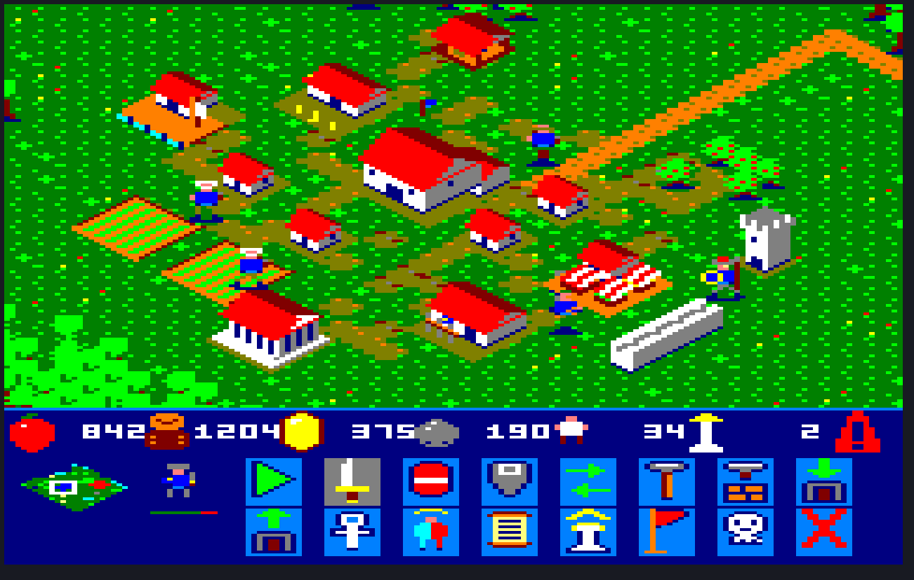

# Polis

Παιχνίδι στρατηγικής πραγματικού χρόνου τύπου **Age of Empires** για
**Amstrad CPC 6128**, σε Mode 0 (160×200, 16 χρώματα).

Ισομετρική ματιά όπως στο Age of Empires (ρόμβος 2:1), τέσσερις εποχές,
οκτώ πολιτισμοί, χάρτες 96×96 (~12,8 οθόνες), **128 ζωντανές μονάδες** με
τεμαχισμένη λογική. Τα **γραφικά είναι έτοιμα**· ο κώδικας ξεκινάει από το M0 (`game/`).



## Το όνομα

**Πόλις** είναι αυτό που χτίζει ο παίκτης — όχι αυτοκρατορία, όχι
στρατόπεδο: μια πόλη-κράτος που μεγαλώνει από τέσσερις χωρικούς σε Θαύμα.
Είναι μία λέξη, διαβάζεται ίδια σε ελληνικά και λατινικά, χωράει στους οκτώ
χαρακτήρες του AMSDOS (`POLIS.BIN`, `RUN"POLIS`), και δεν ακουμπάει σε ξένο
σήμα όπως θα έκανε ένα «Empire».

## Τα τρία έγγραφα

| | |
|---|---|
| [`graphics.md`](graphics.md) | τι υπάρχει ζωγραφισμένο, με ποια λογική και τι δοκιμάστηκε και πετάχτηκε |
| [`usage.md`](usage.md) | πώς μπαίνουν στη μηχανή: μορφή δεδομένων, blitter με μετρημένο κόστος, χρώμα παίκτη, συμπίεση, δισκέτα, χάρτης μνήμης |
| [`milestones.md`](milestones.md) | το σχέδιο υλοποίησης, M0 ώς M14, με κριτήρια αποδοχής |

## Τι υπάρχει

| | πλήθος | ωμά bytes |
|---|---:|---:|
| μονάδες × 21 καρέ | 18 | 59.136 |
| σετ κτιρίων × 33 εικόνες | 8 | 194.624 |
| πλακίδια εδάφους, ρόμβοι 8×8 | 16 | 256 |
| πόροι χάρτη 8×16 | 15 | 1.920 |
| εικονίδια HUD 8×16 | 24 | 3.072 |
| | **σύνολο** | **259.008** |

Καμία πίστα δεν τα θέλει όλα: φορτώνει **δύο** σετ κτιρίων και όσους τύπους
μονάδων παίζουν. Το έδαφος, οι πόροι και το HUD — 5,1 KB — φορτώνονται πάντα
και χωράνε σε μία τράπεζα μαζί με τον ήχο.

## Χτίσιμο

```bash
python3 src/make_sprites.py
```

```bash
python3 src/make_buildings.py
```

```bash
python3 src/make_terrain.py
```

```bash
python3 src/make_carry.py
```

```bash
python3 src/make_compiled.py
```

```bash
python3 src/make_bank6.py
```

```bash
python3 src/make_edges.py
```

```bash
python3 src/mockup.py
```

Το παιχνίδι (από το M0):

```bash
./game/build.sh
```

```bash
python3 src/make_map.py
```

```bash
python3 tests/m1_check.py
```

```bash
python3 tests/m3_check.py
```

```bash
python3 tests/m2_check.py
```

```bash
python3 tests/m4_check.py
```

```bash
python3 tests/m5_check.py
```

```bash
python3 tests/m6_check.py
```

```bash
python3 tests/m7_check.py
```

```bash
python3 tests/m8_check.py
```

```bash
python3 tests/m9_check.py
```

Το `build.sh` βγάζει `build/polis.dsk` (`RUN"POLIS`, και το `AGE3.BIN` με
τις εικόνες της Εποχής του Χαλκού, που το παιχνίδι διαβάζει μόνο του από τη
δισκέτα όταν ανέβεις εποχή) και `build/polis.sna` (θέλει τη δισκέτα στον
οδηγό για την αλλαγή εποχής):
ο χάρτης 96×96, ισομετρικός, με τους πόρους του. Το `make_map.py` γράφει τον
χάρτη (`data/map96.bin`) από το ίδιο σενάριο με το mockup. Το `m1_check.py`
τρέχει το παιχνίδι σε headless CPC 6128 και ελέγχει ότι η οθόνη είναι ίδια
pixel προς pixel με το mockup, σε πέντε θέσεις κάμερας, και μετράει τον
χρόνο (`tests/profile.py` δείχνει πού πάει). Το `tests/m0_check.py` ελέγχει
την παλέτα, το `m3_check.py` τις 16 μονάδες που κινούνται στα 25 Hz
(χρόνος, σύνθεση pixel προς pixel, κανένα σκουπίδι μετά το σβήσιμο), το
`m2_check.py` την κύλιση με τα βελάκια: ο χάρτης στη νέα κάμερα pixel προς
pixel, ως τις τέσσερις άκρες, η οθόνη με το HUD ακίνητο, οι μονάδες ενώ
κυλάει, και οι χρόνοι ανά κατεύθυνση. Το `m4_check.py` παίζει με τα
πλήκτρα: κουτί επιλογής, εντολή κίνησης, άφιξη με τη σωστή όψη, κλικ, ενώ
οι υπόλοιπες από τις 128 μονάδες περιπλανιούνται εκτός οθόνης. Το
`m5_check.py` στέλνει μια μονάδα γύρω από δάσος (φτάνει, χωρίς να πατήσει
εμπόδιο) και μετράει το flow field και τη στόχευση με κάδους. Το
`m6_check.py` στέλνει τους 4 χωρικούς της πόλης σε μούρα, δέντρα και χρυσό,
και ελέγχει σε κάθε καρέ ότι οι αριθμοί της μπάρας ανεβαίνουν ακριβώς όσο
αδειάζουν, ως το άδειασμα μιας πηγής. Το `m7_check.py` χτίζει στρατώνα με
τους χωρικούς, βγάζει δύο σπαθοφόρους και ελέγχει κόστος, εικόνα, δέντρο
και ότι μια μονάδα τον παρακάμπτει· μετά χτίζει αποθήκη, όπου ο χωρικός
αδειάζει το ξύλο, και ελέγχει την κάρτα του HUD, το όριο πληθυσμού και τα 28
κτίρια. Το `m8_check.py` στήνει 6 εναντίον 6 (οι στρατιώτες της πόλης και 6
εχθροί): χωρίς εντολές χτυπάνε, οι τοξότες ρίχνουν βέλη, όποια πέφτει δείχνει
τα καρέ θανάτου και αφήνει τη θέση της, και βγαίνει νικητής· οι εχθροί
είναι κόκκινοι, και μετά: εντολή επίθεσης και χωρικός που απαντάει. Το
`m9_check.py` ανεβαίνει στην Εποχή του Χαλκού (έρευνα στο Κέντρο Πόλης, το
`AGE3.BIN` από τη δισκέτα, μόνο τα κτίρια που αλλάζουν ξαναζωγραφίζονται,
ναός / κυβερνείο / ακαδημία ξεκλειδώνουν) και ερευνά δύο τεχνολογίες.

Χειρισμός: βελάκια = κύλιση, Q A O P (ή joystick) = κέρσορας, SPACE =
επιλογή (κλικ ή κουτί), RETURN/COPY = «πήγαινε εκεί» — πάνω σε δέντρο,
θάμνο μούρων, χρυσό ή πέτρα, οι επιλεγμένοι χωρικοί πάνε να μαζέψουν. Με
χωρικούς επιλεγμένους: C H B G S M R L F W = κτίριο (Κέντρο Πόλης, σπίτι,
στρατώνας, σιταποθήκη, αποθήκη, αγορά, σκοπευτήριο, στάβλος, χωράφι,
πύργος· στη Χαλκού και N K D = ναός, κυβερνείο, ακαδημία), RETURN = εδώ,
ESC = άκυρο. Κλικ σε κτίριο και T = μια μονάδα στην
ουρά του (ως 15 μονάδες, +5 ανά σπίτι)· η κάρτα του HUD δείχνει την ουρά και
την πρόοδο. U = έρευνα στο επιλεγμένο κτίριο: η επόμενη τεχνολογία του
(στο Κέντρο Πόλης η Εποχή του Χαλκού). Οι χωρικοί αδειάζουν στο κοντινότερο Κέντρο Πόλης, σιταποθήκη
(τροφή) ή αποθήκη (ξύλο, χρυσό, πέτρα). Μια μονάδα πίσω από κτίριο φαίνεται
μόνο ως περίγραμμα, στο χρώμα της ομάδας. Οι στρατιώτες (σπαθοφόροι,
τοξότες) χτυπάνε μόνοι τους όποιον εχθρό βρεθεί κοντά, όταν δεν εκτελούν
εντολή· RETURN πάνω σε εχθρό (κόκκινος) = επίθεση, και ο χωρικός που
χτυπιέται απαντάει.

Το πρώτο βγάζει τις μονάδες, το δεύτερο τα κτίρια των οκτώ πολιτισμών, το
τρίτο το έδαφος/πόρους/HUD. Το `make_carry.py` βγάζει τον χωρικό με φορτίο
από τον villager_m, το `make_compiled.py` τα μεταγλωττισμένα sprites
(κώδικας Z80 ανά καρέ, για την τράπεζα C7) από τα 4 σετ του παιχνιδιού, και
το `make_bank6.py` την τράπεζα C6 (πόροι και κτίρια της εποχής) με τον
πίνακα των κτιρίων, και το `make_edges.py` το περίγραμμα κάθε καρέ (για τη
μονάδα πίσω από κτίριο· μετά το `make_map.py`). Όλα γράφουν `data/*.bin` + `*.asm` και
`preview/*.png`.

Το τέταρτο δεν βγάζει δεδομένα, **βγάζει κρίση**: συνθέτει ολόκληρη οθόνη
160×200 με χάρτη, πόρους, κτίρια, μονάδες και HUD μαζί. Τα contact sheets
δείχνουν αν ένα sprite είναι καλό· μόνο η ολόκληρη οθόνη έδειξε ότι κάθε
μονάδα είχε αδιαφανές μαύρο κουτί γύρω της. Τρέξ' το μετά από κάθε αλλαγή.

Βγάζει και ολόκληρο τον χάρτη: **96×96 πλακίδια, ~12,8 οθόνες** χάρτη, με
δύο πόλεις, θάλασσα, λίμνες, δάση και ορυχεία
([`preview/map.png`](preview/map.png), με το πλέγμα των οθονών από πάνω),
και μια διαδρομή της κάμερας πάνω του με τον μίνι χάρτη να ακολουθεί
([`preview/scroll.gif`](preview/scroll.gif)).

Τίποτα στο `data/` δεν γράφεται με το χέρι. Η τέχνη είναι στα `src/*.py` ως
ASCII με έναν χαρακτήρα ανά pixel.

## Τα νούμερα που ορίζουν τα πάντα

**Ένα sprite 8×16 με μάσκα κοστίζει 0,8 ms.** Στα 25 FPS χωράνε **12-16
κινούμενες μονάδες στην οθόνη** — είναι ο blitter και δεν κουνιέται.

**Όσες ζουν στον χάρτη είναι άλλο όριο.** Με τεμαχισμένη λογική — 16 πλήρεις
ενημερώσεις ανά καρέ, κυκλικός δείκτης — φτάνουν οι **128**, με απόφαση ανά
320 ms η καθεμία.

**Η βάση RAM είναι 64 KB και η οθόνη τρώει τα 16.** Τα γραφικά ενός επιπέδου
είναι ~65 KB ωμά (τα ισομετρικά κτίρια είναι τα μισά), άρα **πρέπει** να ζουν στις τράπεζες του 6128
(`OUT (#7Fxx)`, #C4–#C7).

Εργαλεία: **rasm** (assembler, crunchers, EDSK), **iDSK**, **CPCEmu**.
Συμπίεση: **LZX0**.

## Προέλευση

Τα γραφικά φτιάχτηκαν μέσα στο [CPCArt](https://github.com/vaspervnp/CPCArt)
ως φάκελος `empire/` και μετακόμισαν εδώ ολόκληρα, με το ιστορικό τους
γραμμένο μέσα στα ίδια τα αρχεία. Ο κωδικοποιητής `src/cpcimg.py` ήταν
symlink σε κοινό αρχείο του CPCArt και είναι πλέον **αντίγραφο**, ώστε το
repo να χτίζεται με ένα `git clone` και τίποτε άλλο.
