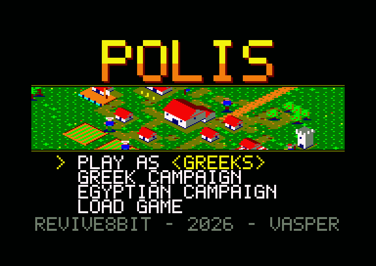
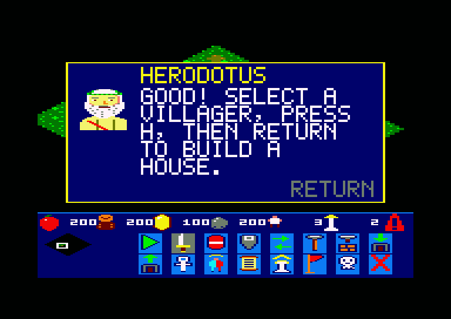
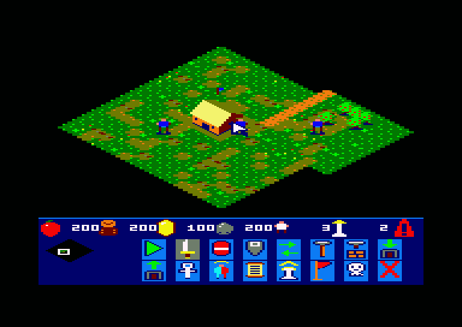
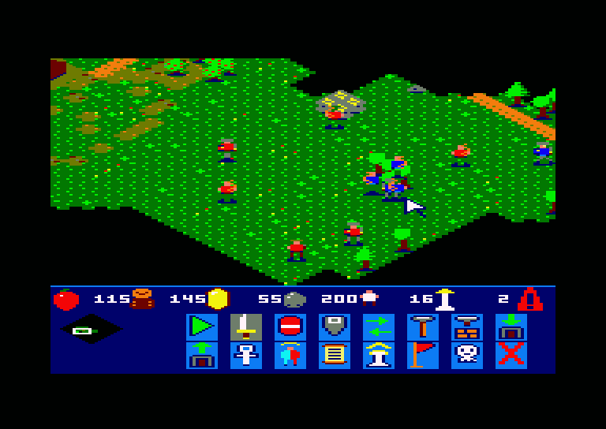
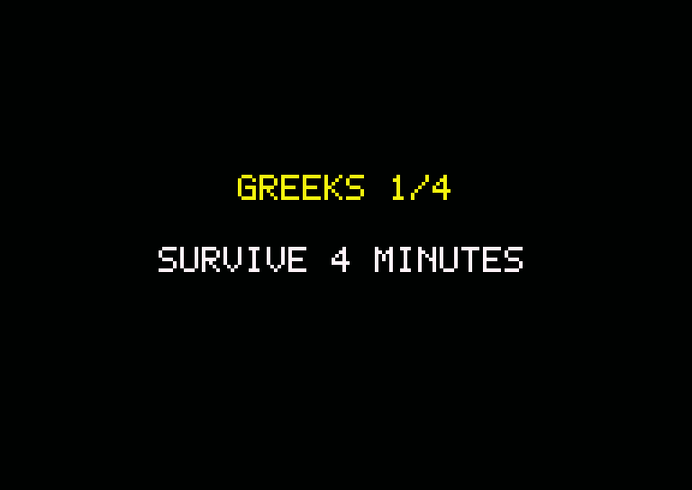

# POLIS — Εγχειρίδιο παίκτη

*Παιχνίδι στρατηγικής πραγματικού χρόνου για Amstrad CPC 6128*
*REVIVE8BIT · 2026 · VASPER*



## 1. Η ιδέα

Ξεκινάς με ένα Κέντρο Πόλης και τρεις χωρικούς, χωρίς στρατιώτες. Οι
χωρικοί μαζεύουν τροφή, ξύλο, χρυσό και πέτρα. Με αυτά χτίζεις κτίρια, βγάζεις μονάδες, ερευνάς
τεχνολογίες, ανεβαίνεις εποχές, και η *πόλις* σου μεγαλώνει. Σε άλλη γωνία
του χάρτη ο αντίπαλος ξεκινά με τον ίδιο τρόπο και κάνει το ίδιο: μαζεύει, χτίζει, φτιάχνει στρατό και
τον στέλνει εναντίον σου σε κύματα.

Ο χάρτης είναι 96 × 96 πλακίδια, περίπου δεκατρείς οθόνες, και τον βλέπεις
σε ισομετρική ματιά. Ό,τι δεν έχουν εξερευνήσει ακόμα οι άνθρωποί σου μένει
μαύρο.

Το κείμενο μέσα στο παιχνίδι είναι στα αγγλικά. Εδώ τα ονόματα των
επιλογών γράφονται όπως στην οθόνη.

## 2. Φόρτωμα

Βάλε τη δισκέτα, γράψε την εντολή και πάτησε **RETURN**. Η οθόνη τίτλου
βγαίνει σε λίγα δευτερόλεπτα.

```
RUN"POLIS
```

Το παιχνίδι θέλει CPC 6128, ή άλλο CPC με 128 KB. Η δισκέτα **δεν** πρέπει
να έχει προστασία εγγραφής, γιατί πάνω της γράφονται οι σωσμένες παρτίδες
και η πρόοδος των εκστρατειών.

## 3. Το tutorial



Αν το Polis είναι καινούριο για σένα, διάλεξε **TUTORIAL** στο μενού. Ο
Ηρόδοτος, ο πατέρας της ιστορίας, βγαίνει σε ένα παράθυρο στη μέση της
οθόνης και εξηγεί το επόμενο βήμα. Όσο μιλάει, το παιχνίδι περιμένει.
Πάτησε **RETURN** (το Enter του PC) για να κλείσει το παράθυρο, και κάνε ό,τι ζήτησε. Μόλις
γίνει, εξηγεί το επόμενο:

1. επιλογή χωρικού·
2. μάζεμα μούρων·
3. ένα Σπίτι·
4. ένας χωρικός από το Κέντρο Πόλης·
5. ένας Στρατώνας·
6. ένας σπαθοφόρος·
7. η πορεία προς την πόλη του αντιπάλου.

Ο αντίπαλος παίζει κανονικά και στο tutorial, αλλά το πρώτο του κύμα
έρχεται μετά από 15 λεπτά.

## 4. Το μενού

| πλήκτρο | ενέργεια |
|---|---|
| **↑ / ↓** | μετακινεί το βέλος |
| **← / →** | στο PLAY AS: διαλέγει πολιτισμό |
| **RETURN**, **SPACE**, **COPY** ή **ENTER** | επιλογή |

* **PLAY AS ‹πολιτισμός›** ξεκινά ελεύθερη παρτίδα εναντίον του
  υπολογιστή.
* **GREEK CAMPAIGN** και **EGYPTIAN CAMPAIGN** έχουν τέσσερις πίστες η
  καθεμία (βλ. ενότητα 11).
* **TUTORIAL** σου μαθαίνει το παιχνίδι βήμα προς βήμα (βλ. ενότητα 3).
* **LOAD GAME** συνεχίζει την παρτίδα που έσωσες με το **V**. Αν δεν
  υπάρχει σωσμένη παρτίδα, ξεκινά καινούρια.

Οι πολιτισμοί είναι οκτώ: Αιγύπτιοι, Έλληνες (η αρχική επιλογή),
Βαβυλώνιοι, Ασιάτες, Ρωμαίοι, Πέρσες, Φοίνικες και Κέλτες. Παίζονται όλοι
με τον ίδιο τρόπο. Από την Εποχή του Χαλκού και μετά, τα κτίρια κάθε
πολιτισμού έχουν τη δική τους όψη.

## 5. Η οθόνη



Πάνω είναι ο κόσμος. Κάτω είναι η μπάρα (HUD).

* **Πάνω σειρά της μπάρας:** τροφή, ξύλο, χρυσός, πέτρα, πληθυσμός και η
  εποχή.
* **Αριστερά στην μπάρα:** ο **μίνι χάρτης**. Δείχνει όλη τη γη όσο την έχεις
  εξερευνήσει, και το πλαίσιο που δείχνει πού είναι η κάμερα.
* **Η κάρτα δίπλα στον μίνι χάρτη:** με κτίριο επιλεγμένο, το ψηφίο λέει
  πόσες μονάδες περιμένουν στην ουρά του. Η μπάρα από κάτω δείχνει την
  πρόοδο της μονάδας που εκπαιδεύεται, της ανέγερσης ή της έρευνας.

Στο τέλος της παρτίδας η κάρτα δείχνει το αποτέλεσμα: μια **κόκκινη σημαία**
σημαίνει νίκη και μια **νεκροκεφαλή** ήττα.

## 6. Χειρισμός

| πλήκτρο | ενέργεια |
|---|---|
| **Q A O P** ή joystick | κινεί τον κέρσορα (στην άκρη της οθόνης ο χάρτης κυλάει) |
| **βελάκια** | κύλιση του χάρτη |
| **SPACE** ή fire | επιλογή: κλικ πιάνει τη μονάδα κάτω από τον κέρσορα, κράτημα και σύρσιμο κάνει κουτί |
| **RETURN**, **ENTER**, **COPY** ή fire 2 | εντολή στις επιλεγμένες (βλ. παρακάτω) |
| **C H B G S M R L F W** | με χωρικούς επιλεγμένους: κτίριο για τοποθέτηση |
| **N K D** | το ίδιο, για τα κτίρια της Εποχής του Χαλκού |
| **RETURN** ή **ENTER** | στην τοποθέτηση: χτίσε εδώ |
| **ESC** | ακύρωση της τοποθέτησης |
| **T** | με κτίριο επιλεγμένο: εκπαίδευση μονάδας |
| **U** | με κτίριο επιλεγμένο: έρευνα της επόμενης τεχνολογίας του |
| **V** | σώσιμο της παρτίδας στη δισκέτα (~2 s) |

Σε emulator στο PC, το **RETURN** είναι το **Enter** του πληκτρολογίου. Το
**ENTER** του CPC (στο αριθμητικό) είναι το Enter του αριθμητικού, και
κάνει το ίδιο παντού.

### Τι κάνει το RETURN

Εξαρτάται από το τι είναι κάτω από τον κέρσορα.

* **Άδειο έδαφος:** οι επιλεγμένες μονάδες πάνε εκεί, σε τέσσερις στήλες.
* **Θάμνος μούρων, δέντρο, χρυσός ή πέτρα:** οι επιλεγμένοι χωρικοί πάνε
  να μαζέψουν.
* **Εχθρική μονάδα** (κόκκινη): επίθεση.
* **Εχθρικό κτίριο:** επίθεση ώσπου να πέσει.

Οι χωρικοί αδειάζουν ό,τι κουβαλάνε στο κοντινότερο κτίριο που το δέχεται:

* το Κέντρο Πόλης δέχεται τα πάντα·
* η Σιταποθήκη δέχεται τροφή·
* η Αποθήκη δέχεται ξύλο, χρυσό και πέτρα.

Οι σπαθοφόροι και οι τοξότες χτυπάνε μόνοι τους όποιον εχθρό βρεθεί κοντά,
όταν δεν εκτελούν δική σου εντολή. Ο χωρικός που δέχεται χτύπημα απαντάει.

## 7. Κτίρια

Για να χτίσεις:

1. Διάλεξε έναν ή περισσότερους χωρικούς.
2. Πάτησε το πλήκτρο του κτιρίου.
3. Φέρε τη γωνία του κέρσορα στο σημείο.
4. Πάτησε **RETURN**.

Το κόστος πληρώνεται αμέσως και μπαίνει θεμέλιο. Οι επιλεγμένοι χωρικοί
πάνε και χτίζουν. Όταν το κτίριο τελειώσει, ακούγεται ένας τόνος.

| πλήκτρο | κτίριο | κόστος | θέλει | τι κάνει |
|---|---|---|---|---|
| C | Κέντρο Πόλης | 200 ξύλο | – | χωρικοί, απόθεση για όλα, οι νέες εποχές |
| H | Σπίτι | 30 ξύλο | – | +5 πληθυσμός |
| B | Στρατώνας | 125 ξύλο | – | σπαθοφόροι |
| G | Σιταποθήκη | 120 ξύλο | – | απόθεση τροφής· Εξημέρωση |
| S | Αποθήκη | 120 ξύλο | – | απόθεση ξύλου, χρυσού, πέτρας· όπλα και θωράκιση |
| M | Αγορά | 150 ξύλο | Σιταποθήκη | οι τεχνολογίες του μαζέματος |
| R | Σκοπευτήριο | 150 ξύλο | Στρατώνας | τοξότες· Τοξοβολία, Σύνθετο τόξο |
| L | Στάβλος | 150 ξύλο | Στρατώνας | χρειάζεται για την Ακαδημία |
| F | Χωράφι | 75 ξύλο | Αγορά | έτοιμο, γίνεται 3 × 3 αγροί, 40 τροφή ο καθένας |
| W | Πύργος | 150 πέτρα | Σιταποθήκη | |
| N | Ναός | 200 ξύλο | Εποχή του Χαλκού | Ιατρική |
| K | Κυβερνείο | 200 ξύλο | Χαλκού, Αγορά | |
| D | Ακαδημία | 200 ξύλο | Χαλκού, Στάβλος | οπλίτες· Φάλαγγα |

Κτίριο διαλέγεις με κλικ (**SPACE**) πάνω του. Το **T** βάζει μία μονάδα
στην ουρά του, που χωράει ως πέντε. Το κόστος πληρώνεται με το πάτημα.

**Πληθυσμός:** ως 15 άνθρωποι, και +5 για κάθε Σπίτι.

## 8. Μονάδες

| μονάδα | από | κόστος | υγεία | ζημιά | |
|---|---|---|---|---|---|
| Χωρικός | Κέντρο Πόλης | 50 τροφή | 25 | 3 | μαζεύει και χτίζει |
| Σπαθοφόρος | Στρατώνας | 35 τροφή, 15 χρυσός | 60 | 8 | μάχη σώμα με σώμα |
| Τοξότης | Σκοπευτήριο | 40 τροφή, 20 ξύλο | 35 | 6 | βέλη από απόσταση |
| Οπλίτης | Ακαδημία | 60 τροφή, 40 χρυσός | 90 | 10 | το βαρύ πεζικό της Χαλκού |

Μονάδα πίσω από κτίριο φαίνεται ως περίγραμμα στο χρώμα της ομάδας της,
ώστε να μη τη χάνεις ποτέ.

## 9. Εποχές και τεχνολογίες

Το παιχνίδι ξεκινά στην **Εποχή των Εργαλείων**. Για να ανέβεις, διάλεξε το
Κέντρο Πόλης και πάτησε **U**:

* **Εποχή του Χαλκού:** 800 τροφή. Ξεκλειδώνει Ναό, Κυβερνείο και Ακαδημία,
  και τα κτίρια του πολιτισμού σου παίρνουν τη νέα τους όψη.
* **Εποχή του Σιδήρου:** 1000 τροφή και 800 χρυσός, από τη Χαλκού.

Το **U** σε άλλο κτίριο ερευνά την πρώτη από τις τεχνολογίες του που
μπορείς να έχεις τώρα. Η πρόοδος φαίνεται στη μπάρα της κάρτας.

| κτίριο | τεχνολογία | κόστος | αποτέλεσμα |
|---|---|---|---|
| Σιταποθήκη | Εξημέρωση | 200 τροφή, 50 ξύλο | ο χωρικός κουβαλάει +5 τροφή |
| Αγορά | Ξυλουργική | 120 τροφή, 75 ξύλο | +5 ξύλο |
| Αγορά | Χρυσωρυχείο | 100 τροφή, 120 ξύλο | +5 χρυσός |
| Αγορά | Λιθοξοΐα | 100 τροφή, 50 πέτρα | +5 πέτρα |
| Αποθήκη | Εργαλειοποιία | 100 τροφή | ζημιά σπαθοφόρου +2 |
| Αποθήκη | Δερμάτινη θωράκιση | 75 τροφή | υγεία σπαθοφόρου +10 |
| Αποθήκη | Μεταλλουργία *(Χαλκού, μετά την Εργαλειοποιία)* | 200 τροφή, 120 χρυσός | ζημιά σπαθοφόρου +3 |
| Αποθήκη | Θώρακας φολίδων *(Χαλκού, μετά τη Δερμάτινη)* | 100 τροφή, 50 χρυσός | υγεία σπαθοφόρου +15 |
| Σκοπευτήριο | Τοξοβολία | 100 τροφή, 50 ξύλο | ζημιά τοξότη +2 |
| Σκοπευτήριο | Σύνθετο τόξο *(Χαλκού, μετά την Τοξοβολία)* | 180 ξύλο, 100 χρυσός | μεγαλύτερο βεληνεκές |
| Ναός | Ιατρική | 120 τροφή, 60 χρυσός | υγεία χωρικού +10 |
| Ακαδημία | Φάλαγγα | 150 τροφή, 100 χρυσός | υγεία οπλίτη +20 |

## 10. Ο αντίπαλος, η νίκη και η ήττα

Ο αντίπαλος είναι ο κόκκινος. Μαζεύει, χτίζει σπίτια και στρατώνα,
εκπαιδεύει στρατιώτες και τους στέλνει σε κύματα στο Κέντρο Πόλης σου.
Στη μεμονωμένη παρτίδα (PLAY) το πρώτο κύμα, 6 στρατιώτες, έρχεται μετά
από 5 λεπτά· κάθε επόμενο έχει δύο στρατιώτες παραπάνω, με τουλάχιστον δύο
λεπτά ανάμεσα. Όταν τελειώσουν οι θάμνοι του, χτίζει κι αυτός χωράφια.
Όταν χτυπηθεί μονάδα σου, ακούγεται ειδοποίηση, το πολύ μία φορά στα δέκα
δευτερόλεπτα.

**Χάνεις** όταν δεν σου μένει καμία μονάδα και κανένα Κέντρο Πόλης, και το
ίδιο ισχύει για τον αντίπαλο. Στο τέλος το παιχνίδι σταματά, και η κάρτα
δίπλα στον μίνι χάρτη δείχνει κόκκινη σημαία (νίκη) ή νεκροκεφαλή (ήττα).



## 11. Οι εκστρατείες



Πριν από κάθε πίστα, μια οθόνη λέει τον στόχο της. Πάτησε ένα πλήκτρο για
να ξεκινήσεις.

* Με τη **νίκη**, η πρόοδος γράφεται στη δισκέτα και η επόμενη πίστα
  φορτώνει μόνη της.
* Με την **ήττα**, ξεκινά ξανά η ίδια πίστα.
* Η εκστρατεία θυμάται πού έμεινες, ακόμα κι αν κλείσεις τον υπολογιστή.
* Μετά την τέταρτη πίστα, η εκστρατεία ξεκινά πάλι από την πρώτη.

| | Έλληνες | Αιγύπτιοι |
|---|---|---|
| 1 | Άντεξε 4 λεπτά | Μάζεψε 300 χρυσό |
| 2 | Μάζεψε 400 χρυσό | Άντεξε 5 λεπτά |
| 3 | Φτάσε στην Εποχή του Σιδήρου | Κατέστρεψε την πόλη |
| 4 | Κατέστρεψε την πόλη | Φτάσε στην Εποχή του Σιδήρου |

Σε κάθε πίστα κερδίζεις επίσης αν εξοντώσεις ολόκληρο τον αντίπαλο.

## 12. Συμβουλές

* Βάλε τους τρεις χωρικούς αμέσως σε δουλειά: δύο στα μούρα, έναν στο
  ξύλο. Το Κέντρο Πόλης ας βγάζει αμέσως κι άλλους.
* Χτίσε νωρίς σπίτι, γιατί με γεμάτο πληθυσμό δεν εκπαιδεύεται τίποτα.
* Στην αρχή δεν έχεις στρατό. Χτίσε στρατώνα πριν έρθει το πρώτο κύμα.
  Κράτα τους στρατιώτες ανάμεσα στο Κέντρο Πόλης και στον δρόμο από όπου
  έρχεται ο εχθρός.
* Σιταποθήκη και Αποθήκη δίπλα στους πόρους: λιγότερος δρόμος σημαίνει
  περισσότερη τροφή και ξύλο.
* Σώζε συχνά με το **V**.
