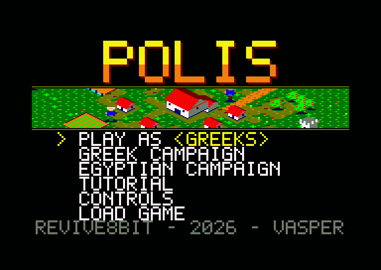
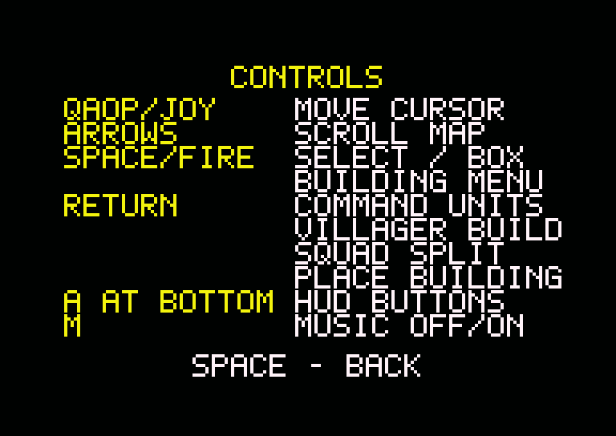
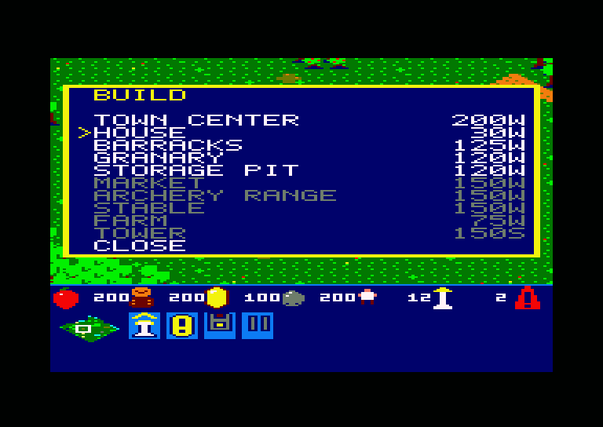
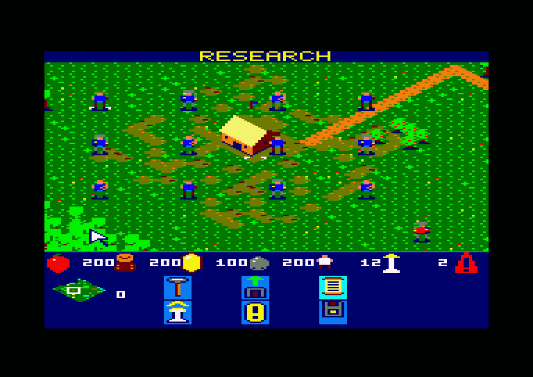
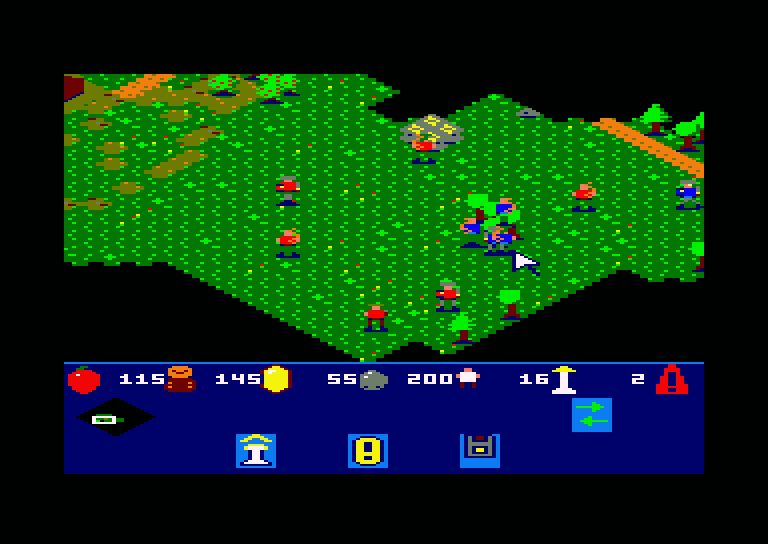

# POLIS — Player's Manual

*A real-time strategy game for the Amstrad CPC 6128*
*REVIVE8BIT · 2026 · VASPER*



## 1. The idea

You start with a Town Center and three villagers, and no soldiers. The
villagers gather food, wood, gold and stone.
You spend these resources on buildings, new units, technologies and new
ages, and your *polis*, a city-state, grows. An enemy city in another
corner of the map starts the same way and does the same. It gathers, builds, raises an army and
sends it against you in waves.

The map is 96 × 96 tiles, about thirteen screens. You see it in isometric
view, and what your people have not explored yet stays black.

## 2. Loading the game

Insert the disc, type the command below and press **RETURN**. The
Revive8bit screen shows for ten seconds (press **SPACE** to skip it), then
the title screen appears after a few more seconds.

```
RUN"POLIS
```

The game needs a CPC 6128, or another CPC with 128 KB. The disc must
**not** be write-protected, because saved games and campaign progress are
written to it.

## 3. The tutorial


Choose **TUTORIAL** in the menu if you are new to Polis. Herodotus, the
father of history, appears in a window in the middle of the screen and
explains the next step. The game waits while he speaks. Press **RETURN**
(Enter on a PC) to close the window, then do what he asked. When you have done it, he
explains the next step:

1. select a villager;
2. gather berries;
3. build a House;
4. train a villager at the Town Center;
5. build Barracks;
6. train a swordsman;
7. march on the enemy city.

The enemy plays normally during the tutorial, but its first wave comes
only after 15 minutes.

## 4. The main menu

| key | action |
|---|---|
| **↑ / ↓** | move the arrow |
| **← / →** | on PLAY AS: choose the culture |
| **RETURN**, **SPACE**, **COPY** or **ENTER** | choose |

* **PLAY AS ‹culture›** starts a free game against the computer.
* **GREEK CAMPAIGN** and **EGYPTIAN CAMPAIGN** each have four levels (see
  section 12).
* **TUTORIAL** teaches you the game step by step (see section 3).
* **CONTROLS** shows a page with the keys (see section 6); any menu key
  takes you back.



* **LOAD GAME** continues the game you saved with **SAVE GAME**. If there is no saved
  game, a new one starts.

There are eight cultures: Egyptians, Greeks (the default), Babylonians,
Asians, Romans, Persians, Phoenicians and Celts. They play the same way.
From the Bronze Age on, each culture's buildings have their own look.

## 5. The screen


The top of the screen is the world. The panel at the bottom is the HUD.

* **Top row of the HUD:** food, wood, gold, stone, population, and the
  current age.
* **Left of the HUD:** the **mini map**. It shows the whole land as far as
  you have explored it, and the frame that marks where the camera is.
* **The buttons** right next to the mini map (see section 6): BUILD, TRAIN,
  RESEARCH, SPLIT SQUAD, NEXT AGE, IDLE VILLAGER, SAVE GAME, CANCEL and
  PAUSE. A button shows only when it can do something right now, and the
  ones that show sit one after the other, in this order, from the top left;
  PAUSE is always the last one.
* **Card to the right of the buttons:** when a building is selected, the
  card shows how many units wait in its queue (the digit). The bar under
  the digit shows the progress of the current unit, of the construction, or
  of the research.

When the game ends, the card shows the result: a **red flag** means you won
and a **skull** means you lost.

**Sound.** Soft music plays in the main menu and, a different tune, during
the game. The game's sound effects come only from what you can see: a
clash of weapons, an arrow, a building finished, a new unit. The closer
it is to the middle of the screen, the louder you hear it; whatever
happens off the screen is silent. Pressing **SPACE** makes a soft click.
Press **M**, in the menu or in the game, to turn the music off or on again;
the sound effects stay.

## 6. Controls

You need only a few keys: **Q A O P** (or the joystick, or the cursor
keys in the menus), **SPACE** and **RETURN**. Everything else is chosen
from a **menu** that opens in the middle of the screen, or from the
**buttons** of the HUD.

| key | action |
|---|---|
| **Q A O P** or joystick | move the cursor (at the edge of the screen the map scrolls) |
| **cursor keys** | scroll the map |
| **SPACE** or fire | select: a click picks the unit under the cursor; hold and drag for a box |
| **SPACE** on one of your buildings | select it and open its menu |
| **RETURN**, **ENTER**, **COPY** or fire 2 | command the selected units (see below) |
| **RETURN** on your selected villagers | open the BUILD menu |
| **RETURN** on your selected squad | open its menu (SPLIT SQUAD) |
| **RETURN** while placing | build here |
| **SPACE** while placing | cancel the placement |
| **M** | music off / on |

### The menus



A menu lists what you can do, with the cost on the right. Move the arrow
with **Q** / **A** (or the cursor keys) and choose with **RETURN** or
**SPACE**. A greyed line is not possible right now: you lack the resources
or the building it needs. **CLOSE**, the last line,
closes the menu. The game waits while a menu is open.

* **BUILD** (RETURN on your villagers) lists the buildings of your age.
* **A building's menu** (SPACE on it) has **TRAIN** and the name of its
  unit, if it trains one, and its technologies that you can research now.
  While it researches, the line reads **RESEARCHING**.
* **A squad's menu** (RETURN on it) has **SPLIT SQUAD**.

### The HUD buttons



Move the cursor down past the bottom of the map and it enters the buttons
of the HUD. **Q A O P** move from button to button; the current one lights
up, and its name appears at the top of the screen. **SPACE** or **RETURN**
presses it. **Q** from the top row takes you back to the map.

Every button also has its own **letter key**, shown in white in the bottom
left corner of its icon and in white inside its name at the top of the
screen. The letter presses the button from anywhere, without moving the
cursor, but only while the button is showing (**U**, for PAUSE, always
works).

A button appears only when it makes sense:

| button | key | appears when | what it does |
|---|---|---|---|
| **BUILD** | **B** | villagers are selected | the BUILD menu |
| **TRAIN** | **T** | one of your buildings that trains units is selected | train one unit |
| **RESEARCH** | **R** | one of your buildings with technologies is selected | its menu |
| **SPLIT SQUAD** | **S** | one of your squads (2 or more) is selected | split it in two |
| **NEXT AGE** | **N** | before the Iron Age | the menu of your Town Center, with the next age |
| **IDLE VILLAGER** | **I** | a villager of yours has nothing to do | select them, and move the view to them |
| **SAVE GAME** | **V** | always | save the game to disc (about 2 seconds) |
| **CANCEL** | **C** | a building is being placed | cancel the placement |
| **PAUSE** | **U** | always | stop the game; the button is now called **CONTINUE**, and pressing it again lets the game go on |

On a PC emulator, **RETURN** is the main **Enter** key. The CPC's **ENTER**
(on the numeric keypad) is the keypad Enter, and does the same everywhere.

### What RETURN does

What happens depends on what is under the cursor.

* **Empty ground:** the selected units walk there, in four columns.
* **Berry bush, tree, gold or stone:** the selected villagers go and gather
  it.
* **An enemy unit** (red): attack it.
* **An enemy building:** attack it until it falls.
* **One of your own squads of the same kind:** the selected squads walk
  there and join it (see section 9).
* **One of the units you have selected:** its menu (BUILD for villagers,
  SPLIT SQUAD for a squad).

Villagers carry their load to the nearest drop site:

* the Town Center takes everything;
* the Granary takes food;
* the Storage Pit takes wood, gold and stone.

Swordsmen and archers attack any enemy that comes near, as long as they are
not carrying out an order of yours. A villager who is attacked fights back.

## 7. Buildings

To build, select one or more villagers, press **RETURN** on them (or the
**BUILD** button) and choose the building. Move the corner of the cursor to
the spot and press **RETURN**. The cost is paid at
once and a foundation appears. The selected villagers walk to it and build.
When the building is finished, you hear a tone (if it is on the screen).

| building | cost | needs | what it does |
|---|---|---|---|
| Town Center | 200 wood | – | villagers, drop site for all, the new ages |
| House | 30 wood | – | +5 population |
| Barracks | 125 wood | – | swordsmen |
| Granary | 120 wood | – | drop site for food; Domestication |
| Storage Pit | 120 wood | – | drop site for wood, gold, stone; weapons and armour |
| Market | 150 wood | Granary | the gathering technologies |
| Archery Range | 150 wood | Barracks | archers; Archery, Composite Bow |
| Stable | 150 wood | Barracks | cavalry; needed for the Academy |
| Farm | 75 wood | Market | when built, 3 × 3 field plots, 40 food each |
| Tower | 150 stone | Granary | shoots arrows at enemies up to 11 tiles away |
| Temple | 200 wood | Bronze Age | Medicine |
| Government Center | 200 wood | Bronze Age, Market | |
| Academy | 200 wood | Bronze Age, Stable | hoplites; Phalanx |

To select a building, click on it with **SPACE**: its menu opens.
**TRAIN** puts one unit in its queue, and the queue holds up to five. The
cost is paid when you choose it.

**Population:** you can have up to 15 people, plus 5 for each House.

**The Tower** shoots on its own: one arrow every second at the nearest enemy
up to 11 tiles away, farther than an archer can shoot. Each arrow does 5 to
12 damage. An enemy villager who is struck charges the tower.

## 8. Units

| unit | from | cost | health | attack | |
|---|---|---|---|---|---|
| Villager | Town Center | 50 food | 25 | 3 | gathers and builds |
| Swordsman | Barracks | 35 food, 15 gold | 60 | 8 | close combat |
| Archer | Archery Range | 40 food, 20 wood | 35 | 6 | shoots arrows from a distance |
| Hoplite | Academy | 60 food, 40 gold | 90 | 10 | the heavy infantry of the Bronze Age |
| Cavalry | Stable | 70 food, 50 gold | 50 | 9 | fast: for raids on the enemy's villagers |

Health and attack are per soldier. A unit standing behind a building is
shown as an outline in its team's colour, so you never lose sight of it.

**Who beats whom.** Hoplites deal double damage to cavalry, cavalry to
archers, and archers to hoplites. Swordsmen have no advantage and no
weakness. A mixed army is stronger than a large army of one kind.

## 9. Squads


Swordsmen, archers, hoplites and cavalry fight in **squads**. A squad is one piece on
the map, of one kind, with a number at its feet: how many soldiers it has,
up to 20. A soldier on his own has no number. Villagers are always single.

* **Training:** a new soldier joins a squad of his kind that stands within
  three tiles of the building, with no order and no fight, and has room.
  Otherwise he becomes a new squad of one.
* **Population** counts people, not pieces: a squad of 8 is 8 people.
* **The card:** with one squad selected, the card shows its number, and the
  bar shows the health of the soldier in front.
* **Joining:** select squads and press **RETURN** over one of your own
  squads of the same kind. They walk there and join it, up to 20; whoever
  does not fit stays as a squad of his own.
* **Splitting:** select one squad of two or more, press **RETURN** on it
  and choose **SPLIT SQUAD** (or use the button). Half of it
  steps onto the next free tile as a new squad.

**In battle** a squad strikes with the attack of its soldiers added up, but
at most three soldiers strike each enemy soldier: 10 swordsmen against a
single one strike like 3. Every blow does between 30% and 100% of its full
damage, at random. The soldier in front takes the blow; when it kills him,
the rest of the damage passes to the next one. The **smaller** squad always
strikes first. Against buildings the whole squad strikes.

The enemy trains into squads too, and its waves come as squads.

## 10. Ages and technologies

The game starts in the **Tool Age**. Click the Town Center (or press the
**NEXT AGE** button) and choose the next age in its menu:

* **Bronze Age:** 800 food. It unlocks the Temple, the Government Center and
  the Academy. The buildings of your culture take their new look.
* **Iron Age:** 1000 food and 800 gold, in the Bronze Age. It unlocks Iron
  Spears and Ballistics.

The menu of any other building lists the technologies you can research
there now; choose one. The bar of the card shows the progress.

| building | technology | cost | effect |
|---|---|---|---|
| Granary | Domestication | 200 food, 50 wood | villagers carry +5 food |
| Market | Woodworking | 120 food, 75 wood | +5 wood carried |
| Market | Gold Mining | 100 food, 120 wood | +5 gold carried |
| Market | Stone Mining | 100 food, 50 stone | +5 stone carried |
| Storage Pit | Toolworking | 100 food | swordsman attack +2 |
| Storage Pit | Leather Armour | 75 food | swordsman health +10 |
| Storage Pit | Metallurgy *(Bronze, after Toolworking)* | 200 food, 120 gold | swordsman attack +3 |
| Storage Pit | Scale Armour *(Bronze, after Leather Armour)* | 100 food, 50 gold | swordsman health +15 |
| Archery Range | Archery | 100 food, 50 wood | archer attack +2 |
| Archery Range | Composite Bow *(Bronze, after Archery)* | 180 wood, 100 gold | longer range |
| Temple | Medicine | 120 food, 60 gold | villager health +10 |
| Academy | Phalanx | 150 food, 100 gold | hoplite health +20 |
| Academy | Iron Spears *(Iron, after Phalanx)* | 200 food, 150 gold | hoplite attack +4 |
| Tower | Ballistics *(Iron)* | 100 wood, 150 stone | tower damage +4 |

## 11. The enemy, victory and defeat

The enemy plays red. It gathers, builds Houses and Barracks, trains soldiers
and sends them against your Town Center in waves. Its villagers gather near
their own Town Center, and go further only when nothing is left close by. After four minutes it
also builds a Stable and trains cavalry, and once you reach the Bronze Age
it builds an Academy and trains hoplites too. In a single game (PLAY)
the enemy first stays in its own city for 5 to 10 minutes (different each
game), building and training as usual. Then its first wave of 6 soldiers
comes. If you strike it first, it waits no longer: the wave leaves as soon
as it is ready. Every next one is two
soldiers bigger, two minutes apart at least. When its berries run out it
builds Farms too.

You **lose** when you have no units and no Town Center left. The enemy loses
the same way. When the game ends, it stops, and the card to the right of
the buttons shows a red flag (victory) or a skull (defeat).



## 12. The campaigns


Before each level, a screen shows its goal. Press a key to start.

* When you **win**, the progress is written to the disc and the next level
  loads by itself.
* When you **lose**, the same level starts again.
* The campaign remembers where you stopped, even after you switch the
  computer off.
* After the fourth level, the campaign starts again from the first.

| | Greeks | Egyptians |
|---|---|---|
| 1 | Survive 4 minutes | Gather 300 gold |
| 2 | Gather 400 gold | Survive 5 minutes |
| 3 | Reach the Iron Age | Destroy the city |
| 4 | Destroy the city | Reach the Iron Age |

You also win any level if you destroy the enemy completely.

## 13. Tips

* Put the three villagers to work at once: two on berries, one on wood.
  Have the Town Center train more right away.
* Build a House early, because a full population stops all training.
* You have no army at the start. Build Barracks before the first wave
  arrives. Keep the soldiers between
  the Town Center and the road the enemy comes on.
* Leave new soldiers next to their Barracks, so they gather into one
  squad. A lone soldier against a squad strikes first, but falls fast.
* A Tower next to the Town Center strikes the waves before they arrive,
  and gives your stone a use.
* Build Granaries and Storage Pits next to the resources. Short trips mean
  more food and wood.
* Save often with the **SAVE GAME** button.
