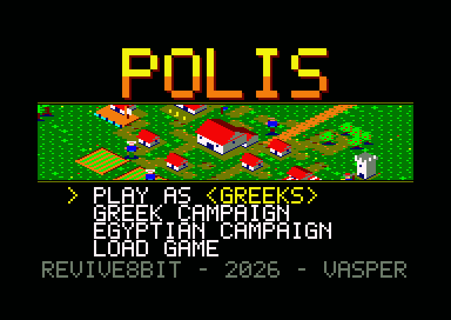
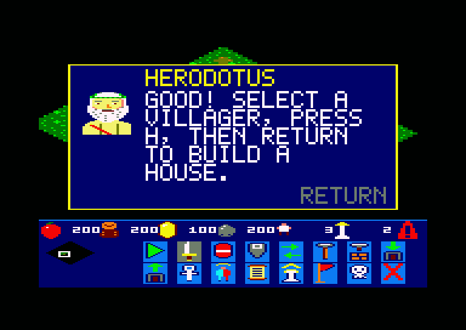
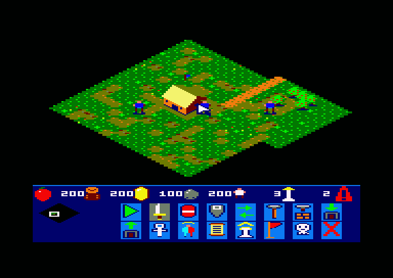
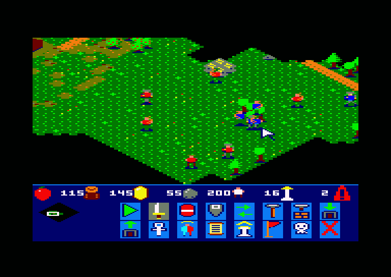
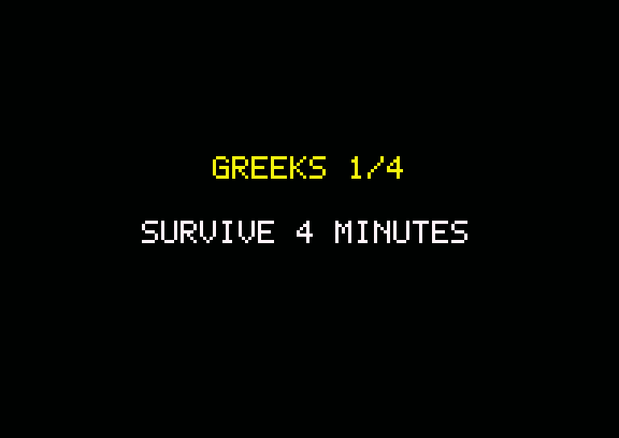

# POLIS — Player's Manual

*A real-time strategy game for the Amstrad CPC 6128*
*REVIVE8BIT · 2026 · VASPER*



## 1. The idea

You start with a Town Center and three villagers, and no soldiers. The
villagers gather food, wood, gold and stone.
You spend these resources on buildings, new units, technologies and new
ages, and your *polis*, a city-state, grows. An enemy city in another
corner of the map starts the same way and does the same. It gathers, builds, raises an army and
sends it against you in waves.

The map is 96 × 96 tiles, about thirteen screens. You see it in isometric
view, and what your people have not explored yet stays black.

## 2. Loading the game

Insert the disc, type the command below and press **RETURN**. The title
screen appears after a few seconds.

```
RUN"POLIS
```

The game needs a CPC 6128, or another CPC with 128 KB. The disc must
**not** be write-protected, because saved games and campaign progress are
written to it.

## 3. The tutorial



Choose **TUTORIAL** in the menu if you are new to Polis. Herodotus, the
father of history, appears in a window in the middle of the screen and
explains the next step. The game waits while he speaks. Press **RETURN**
(Enter on a PC) to close the window, then do what he asked. When you have done it, he
explains the next step:

1. select a villager;
2. gather berries;
3. build a House;
4. train a villager at the Town Center;
5. build Barracks;
6. train a swordsman;
7. march on the enemy city.

The enemy plays normally during the tutorial, but its first wave comes
only after 15 minutes.

## 4. The main menu

| key | action |
|---|---|
| **↑ / ↓** | move the arrow |
| **← / →** | on PLAY AS: choose the culture |
| **RETURN**, **SPACE**, **COPY** or **ENTER** | choose |

* **PLAY AS ‹culture›** starts a free game against the computer.
* **GREEK CAMPAIGN** and **EGYPTIAN CAMPAIGN** each have four levels (see
  section 11).
* **TUTORIAL** teaches you the game step by step (see section 3).
* **LOAD GAME** continues the game you saved with **V**. If there is no saved
  game, a new one starts.

There are eight cultures: Egyptians, Greeks (the default), Babylonians,
Asians, Romans, Persians, Phoenicians and Celts. They play the same way.
From the Bronze Age on, each culture's buildings have their own look.

## 5. The screen



The top of the screen is the world. The panel at the bottom is the HUD.

* **Top row of the HUD:** food, wood, gold, stone, population, and the
  current age.
* **Left of the HUD:** the **mini map**. It shows the whole land as far as
  you have explored it, and the frame that marks where the camera is.
* **Card next to the mini map:** when a building is selected, the card
  shows how many units wait in its queue (the digit). The bar under the
  digit shows the progress of the current unit, of the construction, or of
  the research.

When the game ends, the card shows the result: a **red flag** means you won
and a **skull** means you lost.

## 6. Controls

| key | action |
|---|---|
| **Q A O P** or joystick | move the cursor (at the edge of the screen the map scrolls) |
| **cursor keys** | scroll the map |
| **SPACE** or fire | select: a click picks the unit under the cursor; hold and drag for a box |
| **RETURN**, **ENTER**, **COPY** or fire 2 | command the selected units (see below) |
| **C H B G S M R L F W** | with villagers selected: choose a building to place |
| **N K D** | the same, for the Bronze Age buildings |
| **RETURN** or **ENTER** | while placing: build here |
| **ESC** | cancel the placement |
| **T** | with a building selected: train a unit |
| **U** | with a building selected: research its next technology |
| **V** | save the game to disc (about 2 seconds) |

On a PC emulator, **RETURN** is the main **Enter** key. The CPC's **ENTER**
(on the numeric keypad) is the keypad Enter, and does the same everywhere.

### What RETURN does

What happens depends on what is under the cursor.

* **Empty ground:** the selected units walk there, in four columns.
* **Berry bush, tree, gold or stone:** the selected villagers go and gather
  it.
* **An enemy unit** (red): attack it.
* **An enemy building:** attack it until it falls.

Villagers carry their load to the nearest drop site:

* the Town Center takes everything;
* the Granary takes food;
* the Storage Pit takes wood, gold and stone.

Swordsmen and archers attack any enemy that comes near, as long as they are
not carrying out an order of yours. A villager who is attacked fights back.

## 7. Buildings

To build, select one or more villagers, press the building's key, move the
corner of the cursor to the spot, and press **RETURN**. The cost is paid at
once and a foundation appears. The selected villagers walk to it and build.
When the building is finished, you hear a tone.

| key | building | cost | needs | what it does |
|---|---|---|---|---|
| C | Town Center | 200 wood | – | villagers, drop site for all, the new ages |
| H | House | 30 wood | – | +5 population |
| B | Barracks | 125 wood | – | swordsmen |
| G | Granary | 120 wood | – | drop site for food; Domestication |
| S | Storage Pit | 120 wood | – | drop site for wood, gold, stone; weapons and armour |
| M | Market | 150 wood | Granary | the gathering technologies |
| R | Archery Range | 150 wood | Barracks | archers; Archery, Composite Bow |
| L | Stable | 150 wood | Barracks | needed for the Academy |
| F | Farm | 75 wood | Market | when built, 3 × 3 field plots, 40 food each |
| W | Tower | 150 stone | Granary | |
| N | Temple | 200 wood | Bronze Age | Medicine |
| K | Government Center | 200 wood | Bronze Age, Market | |
| D | Academy | 200 wood | Bronze Age, Stable | hoplites; Phalanx |

To select a building, click on it with **SPACE**. **T** puts one unit in its
queue, and the queue holds up to five. The cost is paid when you press the
key.

**Population:** you can have up to 15 people, plus 5 for each House.

## 8. Units

| unit | from | cost | health | attack | |
|---|---|---|---|---|---|
| Villager | Town Center | 50 food | 25 | 3 | gathers and builds |
| Swordsman | Barracks | 35 food, 15 gold | 60 | 8 | close combat |
| Archer | Archery Range | 40 food, 20 wood | 35 | 6 | shoots arrows from a distance |
| Hoplite | Academy | 60 food, 40 gold | 90 | 10 | the heavy infantry of the Bronze Age |

A unit standing behind a building is shown as an outline in its team's
colour, so you never lose sight of it.

## 9. Ages and technologies

The game starts in the **Tool Age**. Select the Town Center and press **U**
to advance:

* **Bronze Age:** 800 food. It unlocks the Temple, the Government Center and
  the Academy. The buildings of your culture take their new look.
* **Iron Age:** 1000 food and 800 gold, in the Bronze Age.

**U** on any other building researches the first of its technologies that
you can have now. The bar of the card shows the progress.

| building | technology | cost | effect |
|---|---|---|---|
| Granary | Domestication | 200 food, 50 wood | villagers carry +5 food |
| Market | Woodworking | 120 food, 75 wood | +5 wood carried |
| Market | Gold Mining | 100 food, 120 wood | +5 gold carried |
| Market | Stone Mining | 100 food, 50 stone | +5 stone carried |
| Storage Pit | Toolworking | 100 food | swordsman attack +2 |
| Storage Pit | Leather Armour | 75 food | swordsman health +10 |
| Storage Pit | Metallurgy *(Bronze, after Toolworking)* | 200 food, 120 gold | swordsman attack +3 |
| Storage Pit | Scale Armour *(Bronze, after Leather Armour)* | 100 food, 50 gold | swordsman health +15 |
| Archery Range | Archery | 100 food, 50 wood | archer attack +2 |
| Archery Range | Composite Bow *(Bronze, after Archery)* | 180 wood, 100 gold | longer range |
| Temple | Medicine | 120 food, 60 gold | villager health +10 |
| Academy | Phalanx | 150 food, 100 gold | hoplite health +20 |

## 10. The enemy, victory and defeat

The enemy plays red. It gathers, builds Houses and Barracks, trains soldiers
and sends them against your Town Center in waves. In a single game (PLAY)
the first wave of 6 soldiers comes after 5 minutes; every next one is two
soldiers bigger, two minutes apart at least. When its berries run out it
builds Farms too. When one of your units is
struck, you hear a warning, at most once every ten seconds.

You **lose** when you have no units and no Town Center left. The enemy loses
the same way. When the game ends, it stops, and the card next to the mini
map shows a red flag (victory) or a skull (defeat).



## 11. The campaigns



Before each level, a screen shows its goal. Press a key to start.

* When you **win**, the progress is written to the disc and the next level
  loads by itself.
* When you **lose**, the same level starts again.
* The campaign remembers where you stopped, even after you switch the
  computer off.
* After the fourth level, the campaign starts again from the first.

| | Greeks | Egyptians |
|---|---|---|
| 1 | Survive 4 minutes | Gather 300 gold |
| 2 | Gather 400 gold | Survive 5 minutes |
| 3 | Reach the Iron Age | Destroy the city |
| 4 | Destroy the city | Reach the Iron Age |

You also win any level if you destroy the enemy completely.

## 12. Tips

* Put the three villagers to work at once: two on berries, one on wood.
  Have the Town Center train more right away.
* Build a House early, because a full population stops all training.
* You have no army at the start. Build Barracks before the first wave
  arrives. Keep the soldiers between
  the Town Center and the road the enemy comes on.
* Build Granaries and Storage Pits next to the resources. Short trips mean
  more food and wood.
* Save often with **V**.
